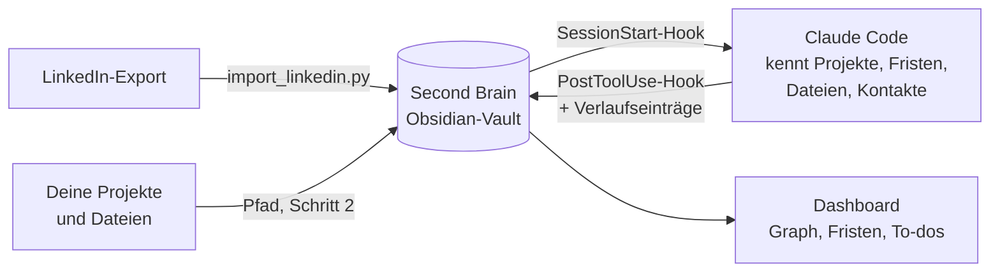

# second brain path

**Ein Pfad, mit dem Claude Code dir in etwa einer Stunde ein Second Brain baut. Du gibst einen Befehl im Terminal ein, Claude macht den Rest und fragt nur bei echten Entscheidungen nach.**

> *English:* A guided path for Claude Code that builds an Obsidian “second brain” from your projects and your LinkedIn data export, then wires it into Claude Code so every session starts with your context. Docs are in German.

---

## Das Problem

Claude Code ist stark, aber **jede Sitzung beginnt bei null.** Claude weiß nicht:

- woran du gerade arbeitest und bis wann
- wo die Dateien zu einem Projekt liegen (`Desktop/Uni/…`? `Downloads/final_v3.docx`?)
- was in der letzten Sitzung passiert ist
- wen du kennst und wer dir bei einem Thema helfen könnte

Also erklärst du alles jedes Mal neu oder bekommst generische Antworten.

## Die Lösung

Ein **Second Brain**: ein Ordner mit Markdown-Notizen (ein Obsidian-Vault), den Claude bei jedem Start automatisch liest und nach jeder Arbeit selbst weiterpflegt.



## Was es dir konkret bringt

| Vorher | Nachher |
|---|---|
| „Ich schreibe eine Bachelorarbeit über …, die Datei liegt in …“ | Claude startet mit: *aktive Projekte, nächste Fristen, nächster Schritt, letzte Arbeit* |
| Dateien suchen | Pro Projekt eine Notiz `Dokumente <Projekt>`, die alle zugehörigen Dateien auf Desktop und in Downloads auflistet |
| „Wen könnte ich für ein Interview fragen?“ | `Wen fragen.md`: deine LinkedIn-Kontakte, sortiert nach Thema und Projekt |
| Vergessene Nachfragen | Liste der Anfragen ohne Antwort und offener Recruiter-Nachrichten |
| Lebenslauf irgendwo | Lebenslauf aus LinkedIn als Notiz, wird bei jedem Import aktuell gehalten |
| Wissen, was Claude letzte Woche gemacht hat? | `Claude-Aktivität.md` und ein Verlauf pro Projekt |
| Überblick im Kopf | Dashboard mit Graph, Projektkarten, Fristen, offenen Punkten |

**Kurz: Claude wird vom Werkzeug, dem man alles erklären muss, zum Assistenten, der deinen Stand kennt.** Das Netzwerk aus LinkedIn wird dabei durchsuchbar. Nicht „350 Kontakte“, sondern „diese 5 Leute passen zu deinem Projekt, und bei diesen 3 hast du nie nachgefragt“.

## So startest du

Voraussetzungen: [Claude Code](https://claude.com/claude-code), `git`, `python3` (auf dem Mac vorinstalliert). Optional [Obsidian](https://obsidian.md).

```bash
git clone https://github.com/arthurengstler-ux/second-brain-path.git
cd second-brain-path
claude
```

Dann in Claude Code eingeben:

```
/second-brain-path
```

Ohne Klonen geht es auch. Gib in einer beliebigen Claude-Code-Sitzung ein:

```
Klone https://github.com/arthurengstler-ux/second-brain-path und arbeite PFAD.md darin Schritt für Schritt mit mir ab.
```

## Die Schritte

Ausführlich in [`PFAD.md`](PFAD.md). Diese Datei ist gleichzeitig die Anleitung für Claude.

| # | Schritt | Was passiert | Deine Rolle |
|---|---|---|---|
| 0 | Kennenlernen | Claude fragt nach Name, Projekten, Dauerthemen | ~5 Fragen beantworten |
| 1 | Vault anlegen | PARA-Ordner, Vorlagen, Dashboard, git | nichts |
| 2 | Projekte | Eine Notiz pro Projekt mit Status, Frist, nächstem Schritt; Regeln, welche Dateien dazugehören | sagen, wo deine Dateien liegen |
| 3 | LinkedIn-Export | Claude erklärt, wo du ihn anforderst | Export anfordern (Basic ~10 min, vollständig ≤ 24 h) |
| 4 | Themen | Claude leitet aus deinen Projekten ab, welche Kontakte wozu passen | Familie zum Auslassen nennen |
| 5 | Import | Lebenslauf, eine Notiz pro Kontakt, `Wen fragen`, Recruiter, Kontaktverlauf | Stichproben ansehen |
| 6 | Claude verbinden | Hooks und CLAUDE.md, damit Claude das Vault bei jedem Start liest und pflegt | einmal zustimmen |
| 7 | Dashboard | Graph und Steuerung in Obsidian oder im Browser | Plugin aktivieren |
| 8 | Abschluss | Zusammenfassung und Wochenroutine | – |

## Was im Repo steckt

```
PFAD.md                         die Schritte (für Claude und Menschen)
.claude/skills/second-brain-path  macht daraus den Befehl /second-brain-path
scripts/setup_vault.py          legt das Vault an (überschreibt nie etwas)
scripts/import_linkedin.py      LinkedIn-Export → Notizen (idempotent, nur Standardbibliothek)
config/themen.example.json      Beispiel: welche Kontakte zu welchem Projekt passen
vault-template/                 PARA-Struktur, Vorlagen, Dashboard (brain.py), Obsidian-Plugin
claude/                         Hooks und CLAUDE.md-Baustein
tests/make_fake_export.py       erfundener Export zum Ausprobieren
```

Ausprobieren ohne eigene Daten:

```bash
python3 -I tests/make_fake_export.py /tmp/fake.zip
python3 -I scripts/setup_vault.py --vault /tmp/test-brain --owner "Max Musters"
python3 -I scripts/import_linkedin.py --vault /tmp/test-brain --zip /tmp/fake.zip --config config/themen.example.json
```

## Datenschutz

- **Alles bleibt lokal** auf deinem Rechner, in deinem Vault, unter deiner git-Kontrolle. Die Skripte senden nichts ins Netz.
- Aus Nachrichten werden **nur Metadaten** übernommen: Datum, Anzahl, grobes Thema, ob geantwortet wurde. Inhalte bleiben draußen.
- E-Mail-Adressen, Telefonnummern, Logins, Suchverlauf und Werbedaten werden nicht importiert.
- Familienmitglieder lassen sich per Nachname ausschließen (`exclude_lastnames`).
- Das Vault gehört **nicht** in ein öffentliches Repository. Dieses Repo enthält nur das Werkzeug, keine Daten.

## Gelernt beim Bauen

- **Nie Ordner löschen und neu anlegen**, wenn das Vault in `~/Documents` liegt. iCloud stellt sonst alte Fassungen als „Name 2.md“ wieder her. Der Importer ändert Dateien deshalb nur an Ort und Stelle.
- **Automatische Zuordnung ist ein Vorschlag.** Die Regeln laufen über Firma und Position. Stichproben lohnen sich, Korrekturen gehören in `themen.json` und nicht in die generierten Listen.
- **Viele Knoten brauchen ein gedämpftes Graph-Layout.** Bei 350 Kontakten flogen die Punkte sonst aus dem Bild. Kraft und Tempo sind deshalb begrenzt.

## Lizenz

MIT
