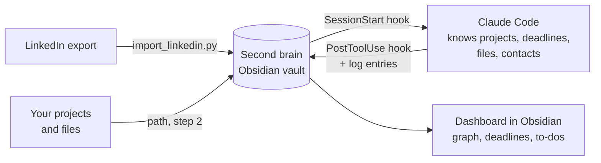

# second brain path

**A guided path that lets Claude Code build you a second brain in about an hour. You type one command, Claude does the rest and only asks when a real decision is yours.**

Works on **macOS, Windows and Linux.**

---

## The problem

Claude Code is powerful, but **every session starts from zero.** Claude does not know:

- what you are working on and by when
- where the files for a project live (`Desktop/Uni/…`? `Downloads/final_v3.docx`?)
- what happened in the last session
- who you know and who could help you with a topic

So you either explain everything again each time, or you get generic answers.

## The solution

A **second brain**: an Obsidian vault of Markdown notes that Claude reads automatically at the start of every session and keeps up to date after every piece of work.



## What you get out of it

| Before | After |
|---|---|
| “I'm writing a thesis on …, the file is in …” | Claude starts with your *active projects, upcoming deadlines, next steps, recent work* |
| Hunting for files | One note per project, `Documents <project>`, listing every related file on Desktop, Downloads and Documents |
| “Who could I ask for an interview?” | `Who to Ask.md`: your LinkedIn contacts, sorted by topic and project |
| Forgotten follow-ups | A list of requests that never got a reply, and of open recruiter messages |
| CV somewhere | Your CV from LinkedIn as a note, refreshed on every import |
| What did Claude do last week? | `Claude Activity.md` and a log per project |
| Overview only in your head | A dashboard in Obsidian with graph, project cards, deadlines and open items |

**In short: Claude goes from a tool you have to brief every time to an assistant that knows where you stand.** Your LinkedIn network becomes searchable along the way. Not “350 contacts”, but “these 5 people fit your project, and these 3 never got a follow-up”.

## Requirements

- [Claude Code](https://claude.com/claude-code)
- [Obsidian](https://obsidian.md) (required: the vault and the dashboard live there)

That's it. Python and git are needed under the hood, but you do not have to set them up: Claude checks them in step 0 and installs anything missing after asking. On macOS both usually ship with the system.

## Start

### Everywhere: one sentence in Claude Code

Open Claude Code in any folder and type:

```
Clone https://github.com/arthurengstler-ux/second-brain-path and walk me through PATH.md step by step.
```

This works the same on macOS, Windows and Linux, because Claude runs every command for you.

### Or clone it yourself and use the slash command

**macOS / Linux** (Terminal):
```bash
git clone https://github.com/arthurengstler-ux/second-brain-path.git
cd second-brain-path
claude
```

**Windows** (PowerShell or Windows Terminal):
```powershell
git clone https://github.com/arthurengstler-ux/second-brain-path.git
cd second-brain-path
claude
```

Then type inside Claude Code:
```
/second-brain-path
```

### What differs per operating system

You don't need to do anything about this, Claude handles it. For reference:

| | macOS | Windows | Linux |
|---|---|---|---|
| Python command | `python3` | `py -3` | `python3` |
| Install Obsidian | `brew install --cask obsidian` or obsidian.md | `winget install Obsidian.Obsidian` | Flatpak or AppImage from obsidian.md |
| Default vault | `~/Documents/Second-Brain` | `%USERPROFILE%\Documents\Second-Brain` | `~/Documents/Second-Brain` |
| Hooks file | `claude/settings.hooks.json` | `claude/settings.hooks.windows.json` | `claude/settings.hooks.json` |
| Watch out for | iCloud sync in `~/Documents` | OneDrive sync in `Documents` | – |

## The steps

The full version is in [`PATH.md`](PATH.md). That file is also the instruction set Claude follows.

| # | Step | What happens | Your part |
|---|---|---|---|
| 0 | Check & get to know you | Claude checks Python, git and Obsidian, then asks about your name, projects and areas | answer ~5 questions |
| 1 | Create the vault | PARA folders, templates, dashboard, git; open it in Obsidian | enable the plugin once |
| 2 | Projects | One note per project with status, deadline, next step; rules for which files belong where | say where your files are |
| 3 | LinkedIn export | Claude tells you where to request it | request it (small archive ~10 min, full ≤ 24 h) |
| 4 | Topics | Claude derives from your projects which contacts fit what | name people to leave out (e.g. family) |
| 5 | Import | CV, one note per contact, `Who to Ask`, recruiters, contact history | look at a few samples |
| 6 | Connect Claude | Hooks and CLAUDE.md, so Claude reads and maintains the vault in every session | approve once |
| 7 | Wrap-up | Summary and a weekly routine | – |

## What's in the repo

```
PATH.md                             the steps (for Claude and for people)
.claude/skills/second-brain-path    turns them into the /second-brain-path command
scripts/setup_vault.py              creates the vault (never overwrites anything)
scripts/import_linkedin.py          LinkedIn export → notes (idempotent, standard library only)
config/topics.example.json          example: which contacts fit which project
vault-template/                     PARA structure, templates, dashboard (brain.py), Obsidian plugin
claude/                             hooks (macOS/Linux and Windows) and a CLAUDE.md snippet
tests/make_fake_export.py           a made-up export to try things out
```

Try it without your own data (macOS/Linux; on Windows use `py -3` and a folder like `%TEMP%`):

```bash
python3 -I tests/make_fake_export.py /tmp/fake.zip
python3 -I scripts/setup_vault.py --vault /tmp/test-brain --owner "Alex Sample's"
python3 -I scripts/import_linkedin.py --vault /tmp/test-brain --zip /tmp/fake.zip --config config/topics.example.json
```

## Privacy

- **Everything stays local**, on your machine, in your vault, under your own git. The scripts send nothing anywhere.
- From messages, **only metadata** is used: date, count, rough topic, whether there was a reply. Contents stay out.
- Email addresses, phone numbers, logins, search history and ad data are not imported.
- Family members can be excluded by last name (`exclude_lastnames`).
- Your vault does **not** belong in a public repository. This repo contains only the tooling, no data.

## Lessons learned while building it

- **Never delete and recreate folders** inside a synced folder (iCloud, OneDrive). The sync brings old versions back as “Name 2.md”. The importer therefore only edits files in place.
- **Automatic matching is a suggestion.** It works on company and position. Spot checks pay off, and fixes belong in `topics.json`, not in the generated lists.
- **Many nodes need a damped graph layout.** With 350 contacts the points flew off screen, so force and speed are capped.

## License

MIT
